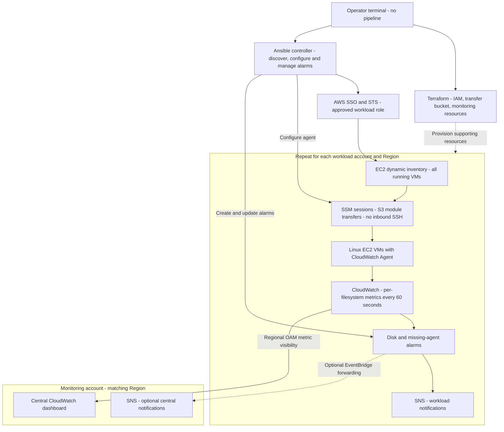
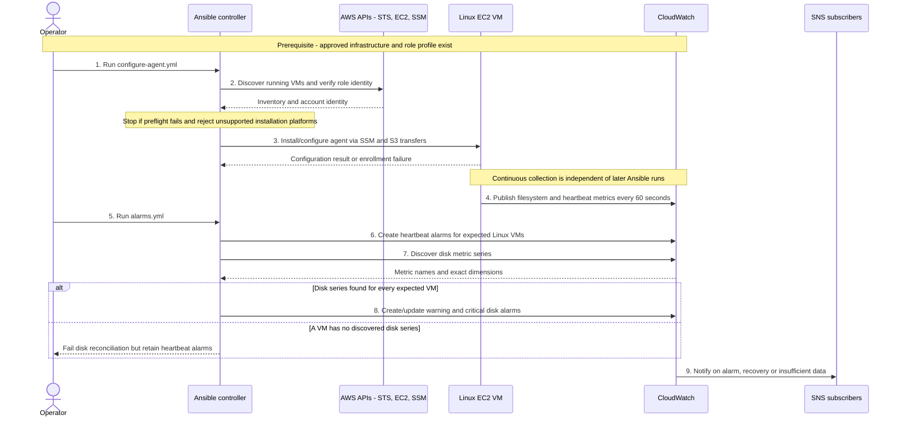

# Architecture and Design Decisions

## High-Level Architecture

SSM/S3 provides secure guest access; CloudWatch provides continuous monitoring.
OAM centralizes visibility across accounts without copying metrics. Workload SNS
is the basic alert path; central event forwarding is optional. A single-account
demo uses its local dashboard and needs neither OAM nor central forwarding.

## Complete Execution Flow

### Numbered Walkthrough

These numbers match the main actions in the sequence diagram: enrollment (1-3)
followed by continuous metric collection and alarm setup (4-9). Step 9 occurs
when an alarm changes state, not on every playbook run.

1. **Start enrollment:** Select the approved account/Region and run `configure-agent.yml` with its named role profile. Supporting infrastructure must already exist.
2. **Discover and validate:** Dynamic inventory finds running VMs; preflight checks the account identity, profile, Region and Linux scope. Failed checks stop the run.
3. **Configure the agent:** Connect through SSM/S3 and install/configure CloudWatch Agent on supported AL2023 hosts. Enrollment failures require remediation.
4. **Collect continuously:** Each configured agent sends filesystem and heartbeat metrics to CloudWatch every 60 seconds, independently of Ansible.
5. **Start alarm setup:** Run `alarms.yml` separately using the same workload profile and Region.
6. **Create heartbeat alarms first:** Add missing-telemetry alarms for expected Linux VMs, even if disk metrics have not appeared.
7. **Discover disk metrics:** Read published disk series and validate their exact instance/mount dimensions. Discovery alone does not prove freshness.
8. **Create disk alarms:** If every expected VM has a discovered series, create/update warning and critical alarms. Otherwise fail disk reconciliation while retaining heartbeat alarms.
9. **Notify operators:** CloudWatch sends alarm, recovery or insufficient-data notifications through SNS. Subscriptions must be configured and confirmed.
The architecture diagram shows **what is connected and where it lives**. This
sequence diagram shows **who performs each action and in what order**. Repeat
discovery, configuration and alarm reconciliation to enroll new accounts or VMs.

Metrics continue after agent setup, independent of controller availability.
Alarm reconciliation is a separate Ansible run. Missing agent samples trigger
the heartbeat alarm. Failed preflight stops the run, and unsupported platforms
fail enrollment explicitly. Cloning the repository does not deploy resources.

## Components And Responsibilities

- **Terraform** provisions access roles, transfer storage, alarm topics,
	dashboards, and optional cross-account integrations.
- **Ansible** discovers EC2 instances, runs shared preflight checks, configures
	CloudWatch Agent, and creates or updates workload-local CloudWatch alarms in
	separate playbooks.
- **CloudWatch Agent** publishes guest filesystem metrics every 60 seconds.
- **CloudWatch** stores and presents metrics, evaluates alarms, and supports
	account/Region dashboard views. OAM provides regional cross-account visibility;
	it does not copy metric data.
- **SNS** receives alarm state notifications. A human notification requires a
	separately configured and confirmed subscription.

## Assignment Coverage

1. **Access management:** SSO/STS, dedicated workload roles, and SSM access are
	configured in Terraform and checked by the shared Ansible preflight.
2. **Collection and presentation:** The agent publishes filesystem metrics;
	 CloudWatch dashboards and alarms provide aggregation and monitoring.
3. **Scalability:** Dynamic EC2 inventory and repeatable per-account/Region runs
	 support growth without a manually maintained VM list.

## Measurement Contract

Disk metrics: `disk_used_percent`, `disk_free`, `disk_total`, 60-second resolution.
Dimensions: `InstanceId`, `path`, `fstype`. `drop_device` and `omit_hostname`
prevent additional identity dimensions. Alarm reconciliation refuses unexpected
dimension sets, avoiding silent alarms on nonexistent series.

The heartbeat uses `mem_used_percent` with `InstanceId`: normal values cannot
breach a negative threshold, but missing samples are treated as breaching.
CloudWatch evaluation/backfill affects timing; this is not an exact outage timer.
An alive heartbeat does not prove every expected mount is still reporting.

## Scope and Extensions

Included in the proposed artifacts: AL2023 agent configuration, dynamic
running-instance inventory, workload-local alarms, CloudWatch dashboards,
regional OAM visibility and optional central event forwarding.

Designed extensions: other Linux distributions, Windows per-drive collection,
inode/absolute-space alarms, event-driven enrollment, scheduled freshness and
mount-expectation reconciliation, alarm retirement, DLQs and incident enrichment.
These are not silently presented as implemented components.

For production, use the existing enterprise Ansible scheduler to refresh each
account/Region at an agreed interval (for example, 15 minutes). Scheduling is
an operating integration, not a deployment pipeline. This repository performs
no automatic enrollment unless an operator or approved scheduler runs it.

References: [CloudWatch Agent configuration](https://docs.aws.amazon.com/AmazonCloudWatch/latest/monitoring/CloudWatch-Agent-Configuration-File-Details.html),
[cross-account observability](https://docs.aws.amazon.com/AmazonCloudWatch/latest/monitoring/CloudWatch-Unified-Cross-Account.html),
[SSM connection](https://docs.ansible.com/projects/ansible/latest/collections/amazon/aws/aws_ssm_connection.html).