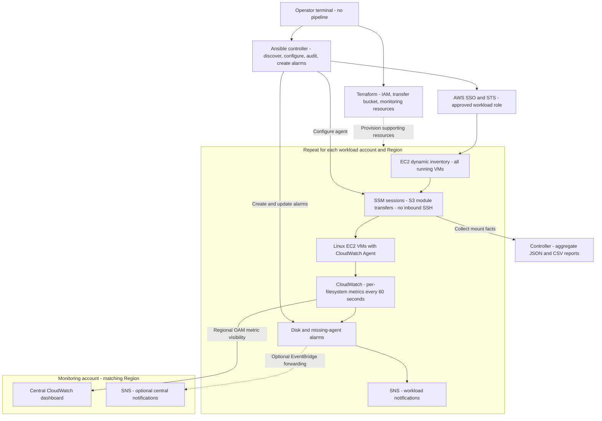
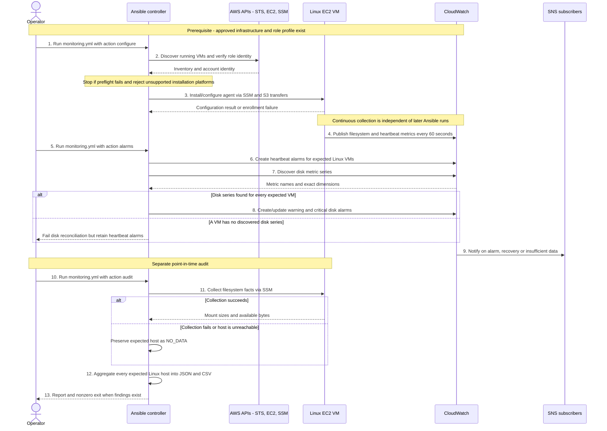

# Architecture and Design Decisions

## High-Level Architecture

SSM/S3 provides secure guest access; CloudWatch provides continuous monitoring.
OAM centralizes visibility across accounts without copying metrics. Workload SNS
is the basic alert path; central event forwarding is optional. A single-account
demo uses its local dashboard and needs neither OAM nor central forwarding.

## Complete Execution Flow

### Numbered Walkthrough

These numbers match the main actions in the sequence diagram. They describe
three separate activities, not one long-running playbook: enrollment (1-3),
continuous monitoring and alarm setup (4-9), and an on-demand audit (10-13).
Step 9 occurs on a relevant alarm state transition, not on every playbook run.

1. **Start enrollment:** Select the approved account/Region and run `monitoring.yml -e monitoring_action=configure` with its named role profile. Supporting infrastructure must already exist.
2. **Discover and validate:** Dynamic inventory finds running VMs; preflight checks the account identity, profile, Region and Linux scope. Failed checks stop the run.
3. **Configure the agent:** Connect through SSM/S3 and install/configure CloudWatch Agent on supported AL2023 hosts. Enrollment failures require remediation.
4. **Collect continuously:** Each configured agent sends filesystem and heartbeat metrics to CloudWatch every 60 seconds, independently of Ansible.
5. **Start alarm setup:** Run `monitoring.yml -e monitoring_action=alarms` separately using the same workload profile and Region.
6. **Create heartbeat alarms first:** Add missing-telemetry alarms for expected Linux VMs, even if disk metrics have not appeared.
7. **Discover disk metrics:** Read published disk series and validate their exact instance/mount dimensions. Discovery alone does not prove freshness.
8. **Create disk alarms:** If every expected VM has a discovered series, create/update warning and critical alarms. Otherwise fail disk reconciliation while retaining heartbeat alarms.
9. **Notify operators:** CloudWatch sends alarm, recovery or insufficient-data notifications through SNS. Subscriptions must be configured and confirmed.
10. **Start an audit:** Run `monitoring.yml -e monitoring_action=audit` when a point-in-time disk and coverage report is needed.
11. **Gather filesystem facts:** Read mount sizes and available space through SSM. Failed or unreachable hosts remain in the report as NO_DATA.
12. **Aggregate results:** Combine every expected Linux host into controller-side JSON and CSV reports, retaining both successful and failed collection results.
13. **Review findings:** Return the reports and a nonzero audit exit when warning, critical or no-data findings exist; assign remediation to the workload owner.

The architecture diagram shows **what is connected and where it lives**. This
sequence diagram shows **who performs each action and in what order**. Repeat
discovery, configuration and alarm reconciliation to enroll new accounts or VMs.

The three paths are distinct: agent metrics run continuously, alarm reconciliation
is an Ansible run, and the audit produces a point-in-time report. Connection or
collection failures produce NO_DATA rather than healthy-looking empty results.
Failed preflight stops the run. Unsupported platforms fail enrollment explicitly.
No deployment occurs merely by cloning the repository or running the fixture demo.

## Deliverable Scope

1. Architecture: the two diagrams above.
2. Minimal working artifacts: Ansible inventory and one monitoring playbook,
   the reporter and fixture tests, and supporting Terraform access resources.
3. Component summary: secure access, VM discovery/enrollment, centralized reporting,
   and repeatable account/Region onboarding in the README and operating guide.

No pipeline, Lambda reconciler, custom monitoring platform or Windows collection
is required for this submission. Existing advanced options remain documented
extensions, not additional implementation work.

Terraform owns infrastructure. Ansible owns guest configuration and dynamic
alarms. Agents publish independently of controller availability; a controller
outage delays enrollment/auditing, not metrics from already-configured VMs.

## Minimal Working Demonstration

Use the numbered walkthrough above for the live-cloud execution path. The
credential-free fixture demo exercises steps 12-13 using simulated input rather
than collecting from real VMs. Regional OAM visibility and optional central
forwarding are infrastructure integrations shown in the architecture diagram,
not additional steps in each audit run.

An agent avoids repeated remote polling as the primary alert mechanism. Ansible
facts provide a simple, reviewable audit and minimum collection/aggregation demo.
The offline fixture exercises aggregation, not real guest collection or AWS APIs.

## Measurement Contract

Disk metrics: `disk_used_percent`, `disk_free`, `disk_total`, 60-second resolution.
Dimensions: `InstanceId`, `path`, `fstype`. `drop_device` and `omit_hostname`
prevent additional identity dimensions. Alarm reconciliation refuses unexpected
dimension sets, avoiding silent alarms on nonexistent series.

The audit uses available bytes from Ansible facts to calculate space unavailable
to applications. Reserved filesystem blocks can make this differ from the
agent's utilization calculation. It is an independent operational audit, not a
claim of byte-for-byte parity with CloudWatch. Audit collection time is one fleet
timestamp, not a continuous freshness guarantee.

The heartbeat uses `mem_used_percent` with `InstanceId`: normal values cannot
breach a negative threshold, but missing samples are treated as breaching.
CloudWatch evaluation/backfill affects timing; this is not an exact outage timer.
An alive heartbeat does not prove every expected mount is still reporting.

## Scope and Extensions

Implemented: AL2023 installation, Linux mount auditing, dynamic running-instance
inventory, workload-local alarms, regional OAM visibility, central forwarding,
and standalone reporting with synthetic fixtures.

Designed extensions: other Linux distributions, Windows per-drive collection,
inode/absolute-space alarms, event-driven enrollment, scheduled freshness and
mount-expectation reconciliation, alarm retirement, DLQs and incident enrichment.
These are not silently presented as implemented components.

For production, use the existing enterprise Ansible scheduler to refresh each
account/Region at an agreed interval (for example, 15 minutes). Scheduling is
an operating integration, not a deployment pipeline. This repository performs
no automatic enrollment unless an operator or approved scheduler runs it.

References: [CloudWatch Agent configuration](https://docs.aws.amazon.com/AmazonCloudWatch/latest/monitoring/CloudWatch-Agent-Configuration-File-Details.html),
[cross-account observability](https://docs.aws.amazon.com/AmazonCloudWatch/latest/monitoring/CloudWatch-Unified-Cross-Account.html),
[SSM connection](https://docs.ansible.com/projects/ansible/latest/collections/amazon/aws/aws_ssm_connection.html).